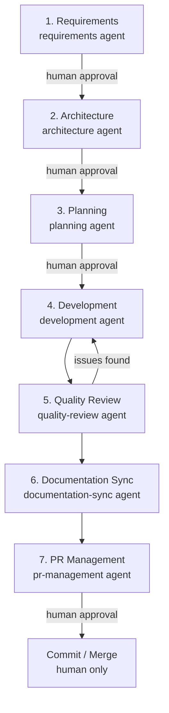

# Agentic SDLC Workflow — Automated Documentation Synchronization (US-001)

This document describes the agent workflow configuration. It is not a generated
run report. The **orchestrator** coordinates; each specialist agent provides a
structured handoff. A human approves at every gate.

All eight custom agents request GPT-6.1 Terra in their frontmatter. Actual model
selection depends on whether the Copilot host and account expose that model.
Detailed role procedures are in `.github/instructions/agent-workflows.instructions.md`;
the agent files themselves stay concise. This project has one consolidated skill,
`.github/skills/documentation-sync/SKILL.md`.

## Agents

| Agent | Role | Deliverable(s) |
|---|---|---|
| `orchestrator` | SDLC coordinator; delegates, tracks phases and approvals | Final `docs/sdlc-report.md` |
| `requirements` | Business analyst for US-001 | Structured requirements handoff |
| `architecture` | Solution architect and design reviewer | Structured architecture/review handoff |
| `planning` | Implementation planner | Structured task-plan handoff |
| `development` | Core Java developer (DocSync engine + demo app) | Source code and tests |
| `quality-review` | QA: review, tests and doc/source validation | Structured findings and test-evidence handoff |
| `documentation-sync` | Doc synchronization specialist | Generated product docs and CLI sync/verify reports |
| `pr-management` | Release/PR manager | Structured PR/reviewer-checklist handoff |

## Workflow phases

### Phase 1 — Requirements
- **Agent:** `requirements`
- **Input:** US-001 story, stakeholder notes
- **Handoff:** functional/non-functional requirements, assumptions, dependencies,
  measurable acceptance criteria and traceability. No phase Markdown file.
- **Gate:** 🧑 Human approves requirements before architecture begins.

### Phase 2 — Architecture
- **Agent:** `architecture`
- **Input:** approved requirements handoff
- **Handoff:** target design, component responsibilities, data flow, risks,
  mitigations and review findings. State clearly which elements are implemented
  versus planned. No phase Markdown file.
- **Gate:** 🧑 Human approves architecture before planning.

### Phase 3 — Planning
- **Agent:** `planning`
- **Input:** approved requirements + architecture handoffs
- **Handoff:** dependency-ordered tasks with scope, owners, AC traceability and
  observable completion criteria. No phase Markdown file.
- **Gate:** 🧑 Human approves the plan before implementation.

### Phase 4 — Development
- **Agent:** `development`
- **Input:** approved implementation-plan handoff
- **Output:** DocSync engine (`org.example.docsync`) and demo app changes;
  code follows project standards (small classes, `PreparedStatement` when SQL
  exists, literal `new Route(...)` declarations and `validationRules`)
- **Rule:** never edits another agent's deliverables.

### Phase 5 — Quality Review
- **Agent:** `quality-review`
- **Input:** implemented code
- **Handoff:** actionable findings and exact JUnit 5/build/verification evidence
  (no claimed-but-unrun tests). No standalone review/test Markdown file.
- **Loop:** defects go back to `development`; re-review after fixes.

### Phase 6 — Documentation Sync
- **Agent:** `documentation-sync`
- **Current pipeline:** full scan of mapped source files → generated-block
  update → validation (`verify`) → sync/verify reports. Git-based impact
  analysis, baseline fallback and selective engine updates are not implemented.
- **Rules:** only generated blocks (`<!-- docsync:begin -->` …
  `<!-- docsync:end -->`) are rewritten; manual content is preserved; every
  generated fact traces to source. The engine currently handles four mapped docs.

### Phase 7 — PR Management
- **Agent:** `pr-management`
- **Input:** all approved phase handoffs and verified evidence
- **Handoff:** readiness checklist, README/changelog recommendations, PR title
  and description, limitations and reviewer checklist.
- **Gate:** 🧑 Human performs the actual commit/merge — agents never do.

## Final workflow report

After all phases and required approvals are complete, the orchestrator writes one
consolidated `docs/sdlc-report.md`. It contains the requirements and AC trace,
architecture and design review, plan/completion record, implementation summary,
documentation-sync changes and CLI evidence, test/review findings, limitations,
approval history, readiness status, and PR title/description/checklist. Do not
create a separate phase report for each agent.

The generated product documentation (`docs/ui/`, `docs/backend/`, `docs/api/`)
and DocSync CLI reports (`docs/reports/sync-report.md`,
`docs/reports/verify-report.md`) remain separate because they are functional
outputs of the product, not per-agent SDLC handoffs. Existing standalone phase
documents are retained as reference material and are not rewritten in new runs
unless the user requests it.

## Global rules

1. **Source code is the source of truth** — docs never drive code.
2. **Human approval gates:** after requirements, architecture, plan, and before
   any commit/merge.
3. **Hand-off through the orchestrator:** specialists return structured phase
   results to the orchestrator; the final lifecycle record is consolidated in
   `docs/sdlc-report.md`.
4. **Ownership:** no agent edits another agent's deliverable.
5. **Security:** no secrets in source/docs; DB credentials via `DB_URL`,
   `DB_USER`, `DB_PASSWORD`; parameterized SQL; validated, bounded input.
6. **Evidence:** test results only count with execution evidence in
   `docs/sdlc-report.md` and the underlying test command output.