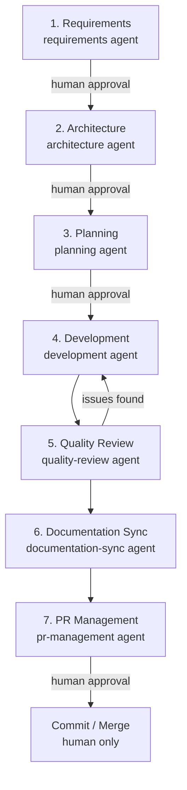

# Agentic SDLC Workflow — Automated Documentation Synchronization (US-001)

This document defines the multi-agent software development lifecycle used in this
project. The **orchestrator** coordinates; each specialist agent owns distinct
deliverables. All hand-offs happen through documents in `docs/`. A human approves
at every gate.

## Agents

| Agent | Role | Deliverable(s) |
|---|---|---|
| `orchestrator` | SDLC coordinator; delegates, tracks phases and approvals | Progress notes |
| `requirements` | Business analyst for US-001 | `docs/requirements.md` |
| `architecture` | Solution architect (change detection, classification, impact analysis, sync flow) | `docs/architecture.md`, `docs/design-review.md` |
| `planning` | Implementation planner | `docs/impl-plan.md` |
| `development` | Core Java developer (DocSync engine + demo app) | Source code in `src/`, `frontend/` |
| `quality-review` | QA: code review, tests, doc-vs-source comparison | `docs/code-review.md`, `docs/test-report.md` |
| `documentation-sync` | Doc synchronization specialist | `docs/ui/`, `docs/backend/`, `docs/api/`, `docs/reports/sync-report.md` |
| `pr-management` | Release/PR manager; verifies deliverables, prepares PR | README/changelog updates, PR description |

## Workflow phases

### Phase 1 — Requirements
- **Agent:** `requirements`
- **Input:** US-001 story, stakeholder notes
- **Output:** `docs/requirements.md` (functional/non-functional requirements,
  assumptions, dependencies, acceptance criteria)
- **Gate:** 🧑 Human approves requirements before architecture begins.

### Phase 2 — Architecture
- **Agent:** `architecture`
- **Input:** approved `docs/requirements.md`
- **Output:** `docs/architecture.md` — Git change detection, change classification
  (UI / BACKEND / API), impact analysis, sync pipeline design; `docs/design-review.md`
- **Gate:** 🧑 Human approves architecture before planning.

### Phase 3 — Planning
- **Agent:** `planning`
- **Input:** approved requirements + architecture
- **Output:** `docs/impl-plan.md` — dependency-ordered tasks with scope and
  acceptance criteria
- **Gate:** 🧑 Human approves the plan before implementation.

### Phase 4 — Development
- **Agent:** `development`
- **Input:** approved `docs/impl-plan.md`
- **Output:** DocSync engine (`org.example.docsync`) and demo app changes;
  code follows project standards (small classes, `PreparedStatement`, extractable
  conventions: `route(...)` registrations, `validationRules`, `READ_ONLY_FIELDS`)
- **Rule:** never edits another agent's deliverables.

### Phase 5 — Quality Review
- **Agent:** `quality-review`
- **Input:** implemented code
- **Output:** `docs/code-review.md`, `docs/test-report.md` (JUnit 5 execution
  evidence required — no claimed-but-unrun tests)
- **Loop:** defects go back to `development`; re-review after fixes.

### Phase 6 — Documentation Sync
- **Agent:** `documentation-sync`
- **Pipeline:** change detection (Git diff / baseline) → classification →
  impact analysis → doc update → validation (`verify`) → `docs/reports/sync-report.md`
- **Rules:** only generated blocks (`<!-- docsync:begin -->` … `<!-- docsync:end -->`)
  are rewritten; manual content preserved; only impacted docs touched; every
  documented fact traces to source.

### Phase 7 — PR Management
- **Agent:** `pr-management`
- **Input:** all phase deliverables
- **Output:** verified deliverable checklist, README/changelog updates, PR
  description and reviewer checklist
- **Gate:** 🧑 Human performs the actual commit/merge — agents never do.

## Global rules

1. **Source code is the source of truth** — docs never drive code.
2. **Human approval gates:** after requirements, architecture, plan, and before
   any commit/merge.
3. **Hand-off via `docs/`:** no agent-to-agent side channels.
4. **Ownership:** no agent edits another agent's deliverable.
5. **Security:** no secrets in source/docs; DB credentials via `DB_URL`,
   `DB_USER`, `DB_PASSWORD`; parameterized SQL; validated, bounded input.
6. **Evidence:** test results only count with execution evidence in
   `docs/test-report.md`.